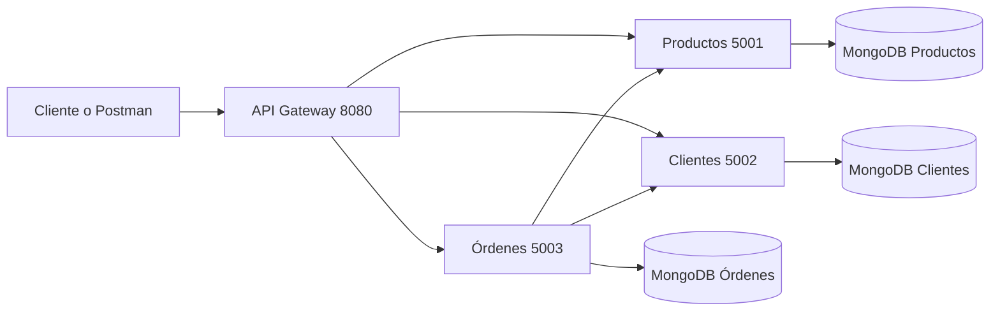

# Tarea Corta 2 API Gateway y Microservicios

Proyecto práctico del curso Programación V del Colegio Universitario de Cartago. Implementa tres microservicios independientes, persistencia NoSQL con MongoDB y un API Gateway como punto de entrada único.

## Arquitectura

| Componente | Puerto | Base de datos | Responsabilidad |
| --- | ---: | --- | --- |
| API Gateway | `8080` | No aplica | Routing, agregación, transformación de cabeceras y observabilidad |
| Productos | `5001` | `cuc_productos_db` | Catálogo e inventario |
| Clientes | `5002` | `cuc_clientes_db` | Registro y consulta de clientes |
| Órdenes | `5003` | `cuc_ordenes_db` | Pedidos y comunicación entre servicios |

El consumidor utiliza únicamente `http://localhost:8080`. El Gateway reenvía cada solicitud al servicio correspondiente.



## Requisitos

- Node.js 18 o superior.
- MongoDB disponible en `localhost:27017`.
- Postman para ejecutar la colección de pruebas.

## Instalación y ejecución

Desde la raíz del repositorio:

```bash
npm run install:all
npm run seed
npm start
```

También se puede iniciar la solución con `Iniciar_Todo.bat` en Windows.

`npm start` levanta simultáneamente el Gateway y los tres microservicios. Los registros de consola muestran el método, la ruta, el identificador de solicitud, el código HTTP y el tiempo de respuesta.

## Endpoints principales

### Gateway

| Método | Ruta | Descripción |
| --- | --- | --- |
| `GET` | `/health` | Estado del Gateway y servicios configurados |
| `GET` | `/api/dashboard` | Resumen consolidado de los tres servicios |
| `GET` | `/api/resumen-orden/:id` | Orden enriquecida con cliente y productos |

### Productos

| Método | Ruta |
| --- | --- |
| `GET` | `/api/productos` |
| `GET` | `/api/productos/:id` |
| `POST` | `/api/productos` |
| `PUT` | `/api/productos/:id` |
| `DELETE` | `/api/productos/:id` |

### Clientes

| Método | Ruta |
| --- | --- |
| `GET` | `/api/clientes` |
| `GET` | `/api/clientes/:id` |
| `POST` | `/api/clientes` |
| `PUT` | `/api/clientes/:id` |
| `DELETE` | `/api/clientes/:id` |

### Órdenes

| Método | Ruta | Descripción |
| --- | --- | --- |
| `GET` | `/api/ordenes` | Lista las órdenes |
| `GET` | `/api/ordenes/:id` | Consulta una orden |
| `POST` | `/api/ordenes` | Valida cliente y productos antes de crear la orden |
| `PUT` | `/api/ordenes/:id/estado` | Actualiza el estado |
| `DELETE` | `/api/ordenes/:id` | Cancela una orden |

## Políticas implementadas

- Routing por prefijo de ruta.
- Reescritura de rutas antes de enviar la solicitud al microservicio.
- Cabeceras de trazabilidad `X-Request-Id` y `X-Gateway-Processed-By`.
- Agregación mediante `/api/resumen-orden/:id` y `/api/dashboard`.
- Logs centralizados con estado HTTP y tiempo de ejecución.
- Comunicación entre Órdenes, Clientes y Productos.

## Pruebas con Postman

Importe la colección [Tarea2_API_Gateway.postman_collection.json](postman/Tarea2_API_Gateway.postman_collection.json). La variable `base_url` está configurada con `http://localhost:8080`.

La colección contiene pruebas para:

- Health Check del Gateway.
- Operaciones de productos y clientes.
- Creación de órdenes con validación entre servicios.
- Agregación de información.
- Inspección de cabeceras del Gateway.

## Video de demostración

[Ver demostración del API Gateway en YouTube](https://youtu.be/CqaZxxMn_1I)

## Documentación y entregables

- [Investigación sobre API Gateways](docs/Investigacion_API_Gateways_CUC.md)
- [Investigación en PDF](docs/Tarea%20Corta%202%20-%20Investigación%20API%20Gateways%20y%20Microservicios%20-%20CUC.pdf)
- [Matriz de responsabilidades](docs/Matriz_Responsabilidades.xlsx)
- [Documento de evidencias](docs/Documento_Evidencias_Pantallazos.docx)
- [Evidencias en Markdown](docs/Documento_Evidencias_Pantallazos.md)

## Estructura del repositorio

```text
Tarea2-ApiGateway/
├── gateway/                    # API Gateway
├── services/
│   ├── productos-service/
│   ├── clientes-service/
│   └── ordenes-service/
├── postman/                    # Colección de pruebas
├── docs/                       # Documentos y evidencias
├── seed.js                     # Datos iniciales para MongoDB
├── package.json                # Scripts generales
└── README.md
```

## Integrantes

- Héctor Román Arrieta
- Ramsés Aguilar Monge
- Alejandro Morales
- Fabián Espinoza Méndez
- José Rodolfo Morales Calderón
