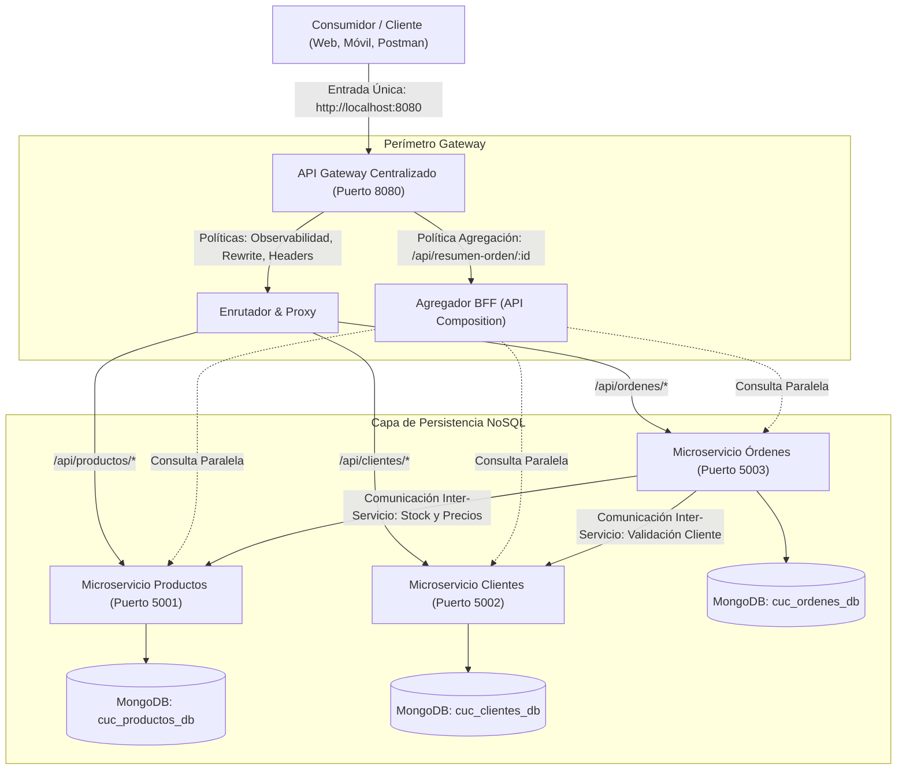

# Tarea Corta 2: Arquitectura de Microservicios con API Gateway y Persistencia NoSQL

**Curso:** Programación V  
**Institución:** Colegio Universitario de Cartago (CUC)  
**Profesor:** Prof. Ing. Gabriel González Solano  
**Integrantes del Equipo:**  
- Héctor Román Arrieta  
- Ramsés Aguilar Monge  
- Alejandro Morales  
- Fabián Espinoza Méndez  
- José Rodolfo Morales Calderón  
**Fecha:** Octubre 2026  

---

## 🏛️ 1. Arquitectura del Sistema

El sistema implementa una arquitectura desacoplada de microservicios con un **API Gateway centralizado** como punto de entrada único (*Single Entry Point*), persistencia en bases de datos **NoSQL (MongoDB)** independientes por microservicio (*Database-per-Service*), comunicación inter-servicio y políticas de observabilidad, transformación y agregación de datos.



---

## 📋 2. Distribución de Servicios y Puertos

| Servicio | Puerto | Base de Datos NoSQL | Responsabilidad Principal |
|---|---|---|---|
| **API Gateway** | `8080` | N/A (Stateless) | Punto de entrada único, enrutamiento, agregación BFF, inyección de cabeceras y logging centralizado. |
| **Productos-Service** | `5001` | `cuc_productos_db` | Catálogo de productos, control de inventario y descuento de stock. |
| **Clientes-Service** | `5002` | `cuc_clientes_db` | Registro y gestión de clientes y datos de contacto. |
| **Ordenes-Service** | `5003` | `cuc_ordenes_db` | Procesamiento de pedidos con validación inter-servicio (Clientes y Productos). |

---

## 🚀 3. Requisitos Previos e Instalación

### Requisitos:
1. **Node.js** (v18 o superior). Verificado en v24.
2. **MongoDB** en ejecución local en el puerto `27017` (o MongoDB Atlas configurado en los archivos `.env`).

### Instalación Rápida:

Desde la raíz del proyecto (`Tarea2-ApiGateway`):

```bash
# 1. Instalar todas las dependencias del Gateway y de los 3 microservicios
npm run install:all

# 2. Sembrar datos de prueba iniciales en MongoDB
npm run seed

# 3. Iniciar todos los microservicios y el API Gateway simultáneamente
npm start
```

> **Nota:** El comando `npm start` utiliza `concurrently` para levantar los 4 servicios en paralelo con logs de colores diferenciados para cada uno.

---

## 🛠️ 4. Guía de Endpoints del API Gateway (`http://localhost:8080`)

Todos los microservicios se consumen exclusivamente a través del puerto **8080**:

### A. Gateway & Agregación
| Método | Endpoint en Gateway | Descripción |
|---|---|---|
| `GET` | `/health` | Estado del Gateway y lista de servicios aguas abajo. |
| `GET` | `/api/dashboard` | **Política de Agregación:** Conteo general consolidado de los 3 microservicios. |
| `GET` | `/api/resumen-orden/:id` | **Política de Agregación (BFF):** Consulta la orden, inyecta los datos completos del cliente y el detalle enriquecido de cada producto. |

### B. Microservicio de Productos (Enrutado a `5001`)
| Método | Endpoint en Gateway | Descripción |
|---|---|---|
| `GET` | `/api/productos` | Lista todos los productos disponibles. |
| `GET` | `/api/productos/:id` | Obtiene un producto por su ID. |
| `POST` | `/api/productos` | Crea un nuevo producto (`nombre`, `precio`, `stock`, `categoria`). |
| `PUT` | `/api/productos/:id` | Actualiza un producto existente. |
| `DELETE` | `/api/productos/:id` | Elimina un producto. |

### C. Microservicio de Clientes (Enrutado a `5002`)
| Método | Endpoint en Gateway | Descripción |
|---|---|---|
| `GET` | `/api/clientes` | Lista todos los clientes registrados. |
| `GET` | `/api/clientes/:id` | Obtiene los detalles de un cliente por ID. |
| `POST` | `/api/clientes` | Registra un nuevo cliente (`identificacion`, `nombre`, `correo`, `telefono`). |
| `PUT` | `/api/clientes/:id` | Actualiza datos del cliente. |
| `DELETE` | `/api/clientes/:id` | Elimina un cliente. |

### D. Microservicio de Órdenes (Enrutado a `5003` con Comunicación Inter-Servicio)
| Método | Endpoint en Gateway | Descripción |
|---|---|---|
| `GET` | `/api/ordenes` | Lista todas las órdenes. |
| `GET` | `/api/ordenes/:id` | Obtiene una orden por su ID. |
| `POST` | `/api/ordenes` | **Crea una orden validando inter-servicio:** valida la existencia del cliente, consulta el stock/precio de cada producto y descuenta el inventario automáticamente. |
| `PUT` | `/api/ordenes/:id/estado` | Cambia el estado (`PENDIENTE`, `PAGADA`, `ENVIADA`, `CANCELADA`). |
| `DELETE` | `/api/ordenes/:id` | Cancela una orden. |

---

## 🎯 5. Demostración de Requerimientos Obligatorios

### 1. Entrada Única
Toda comunicación externa se realiza contra `http://localhost:8080`. Los puertos internos `5001`, `5002` y `5003` no necesitan ser expuestos al cliente final.

### 2. Enrutamiento Dinámico (Routing)
El Gateway analiza el prefijo de la URI (`/api/productos`, `/api/clientes`, `/api/ordenes`) y despacha la petición al microservicio correspondiente.

### 3. Políticas Adicionales Implementadas
1. **Transformación de Cabeceras y Rutas:**
   - Reescritura de ruta (`/api/productos` -> `/productos`).
   - Inyección de cabeceras de trazabilidad en peticiones internas: `X-Gateway`, `X-Forwarded-Host`, `X-Request-Id`, `X-Gateway-Timestamp`.
   - Inyección de cabecera de confirmación en la respuesta: `X-Gateway-Processed-By: CUC-API-Gateway`.
   - Eliminación de encabezados sensibles internos (`X-Powered-By`).
2. **Agregación de Datos (BFF / API Composition):**
   - Endpoint: `GET /api/resumen-orden/:id`.
   - Consulta concurrentemente los 3 servicios para componer un solo objeto enriquecido sin que el cliente deba realizar múltiples viajes de red (*Chatty I/O*).

### 4. Comunicación Inter-Servicio
Al ejecutar un `POST /api/ordenes`:
- `ordenes-service` llama mediante HTTP a `clientes-service` para verificar si el cliente existe.
- `ordenes-service` llama a `productos-service` para comprobar existencias.
- `ordenes-service` ejecuta una llamada `PATCH /productos/:id/descontar-stock` para actualizar el inventario.

### 5. Observabilidad Mínima
Tanto el Gateway como cada microservicio registran en consola:
- Marca de tiempo ISO.
- Método HTTP y URL.
- Identificador único de solicitud (`ReqId`).
- Código de estado de respuesta y tiempo de ejecución en milisegundos (`Tiempo: Xms`).

---

## 📮 6. Pruebas con Postman

En la carpeta [`postman/`](file:///c:/Users/jm076/OneDrive/Desktop/GITHUB%20RAMSES/Tarea2-ApiGateway/postman) se encuentra el archivo:
- `Tarea2_API_Gateway.postman_collection.json`

### Cómo Importar en Postman:
1. Abre Postman.
2. Haz clic en **Import**.
3. Selecciona el archivo JSON de la carpeta `postman`.
4. La colección viene preconfigurada con la variable `base_url = http://localhost:8080` y todas las peticiones organizadas en carpetas con ejemplos listos para probar.

---

## 📁 7. Estructura de Entregables del Proyecto

```text
Tarea2-ApiGateway/
├── gateway/                             # API Gateway Centralizado (Puerto 8080)
│   ├── src/routes/aggregationRoutes.js  # Rutas de agregación (BFF)
│   ├── server.js                        # Configuración de Express, proxy y middlewares
│   └── package.json
├── services/
│   ├── productos-service/               # Microservicio de Productos (Puerto 5001)
│   │   ├── src/models/Producto.js       # Modelo NoSQL Mongoose
│   │   ├── src/controllers/             # Lógica CRUD y descuento de stock
│   │   └── server.js
│   ├── clientes-service/                # Microservicio de Clientes (Puerto 5002)
│   │   ├── src/models/Cliente.js        # Modelo NoSQL Mongoose
│   │   ├── src/controllers/             # Lógica CRUD de clientes
│   │   └── server.js
│   └── ordenes-service/                 # Microservicio de Órdenes (Puerto 5003)
│       ├── src/models/Orden.js          # Modelo NoSQL Mongoose
│       ├── src/controllers/             # Lógica con comunicación inter-servicio
│       └── server.js
├── docs/
│   ├── Investigacion_API_Gateways_CUC.md    # Documento de investigación formal en APA
│   ├── Investigacion_API_Gateways_CUC.html  # Versión imprimible para generar el PDF (Ctrl+P)
│   ├── Matriz_Responsabilidades.csv         # Matriz de responsabilidades para Excel
│   └── Guia_Grabacion_Video_5min.md         # Guión paso a paso para el video de 5 minutos
├── postman/
│   └── Tarea2_API_Gateway.postman_collection.json  # Suite de pruebas completa
├── seed.js                              # Poblador de datos de prueba en MongoDB
├── package.json                         # Scripts de ejecución concurrente
└── README.md                            # Documentación técnica general
```
