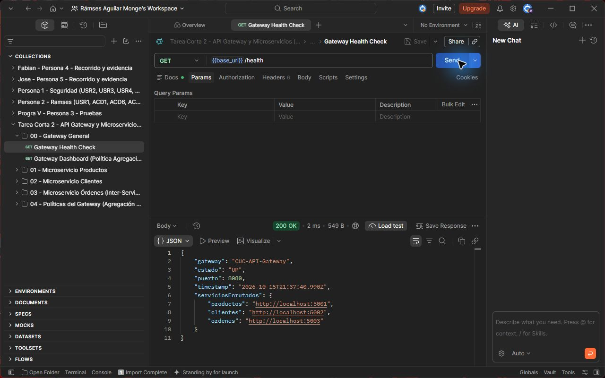
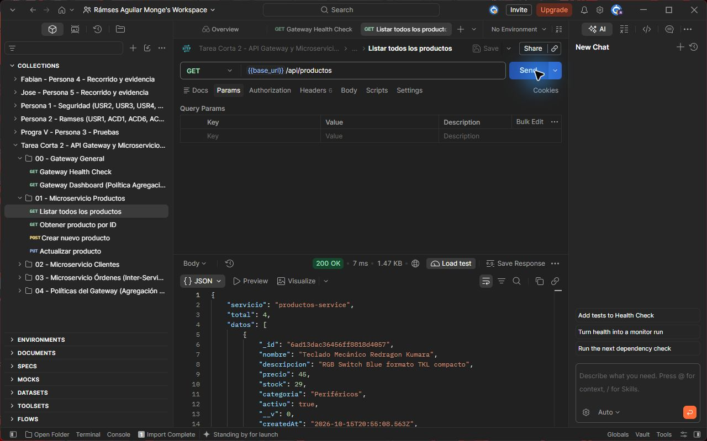
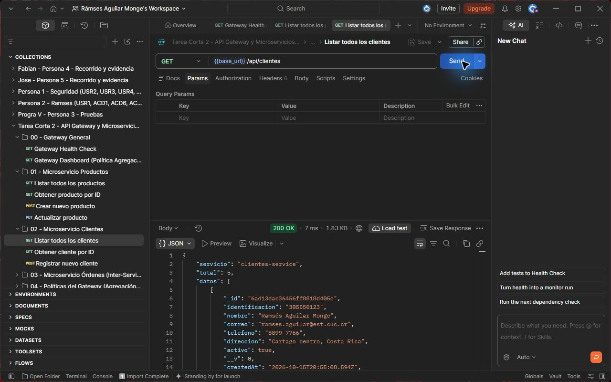
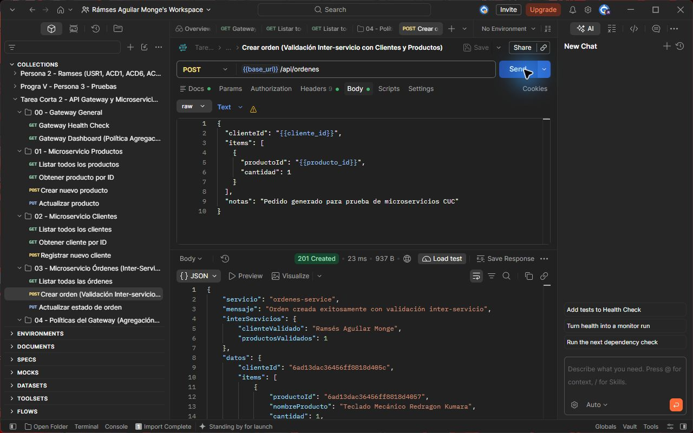
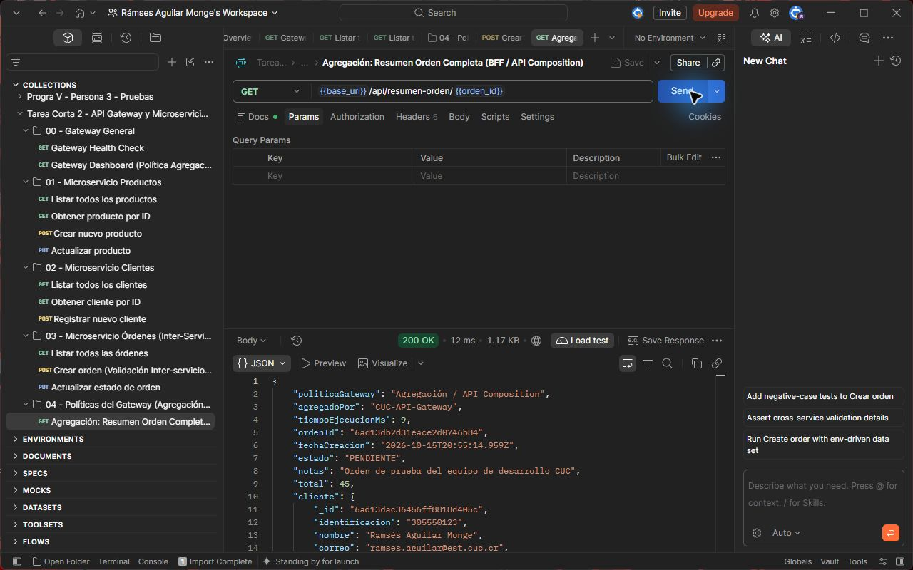
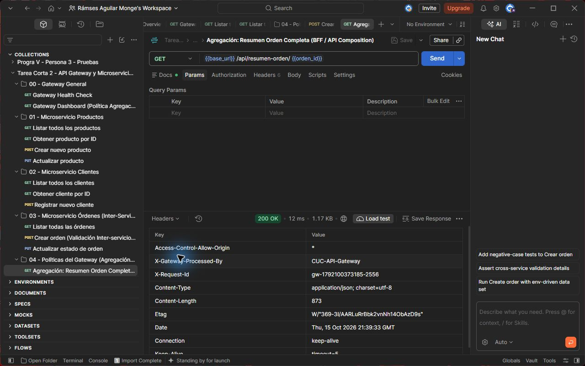

# Evidencias de ejecución del API Gateway y los microservicios

Documento complementario de la Tarea Corta 2 de Programación V. Las capturas fueron tomadas directamente en Postman mientras el proyecto se encontraba en ejecución local.

## Datos generales

- Institución: Colegio Universitario de Cartago
- Docente: Prof. Ing. Gabriel González Solano
- Fecha de entrega: 15 de octubre de 2026
- Entrada única: `http://localhost:8080`

## Evidencia 1 Health Check

La solicitud `GET /health` responde `200 OK` y confirma que el Gateway está activo.

## Evidencia 2 Productos

La solicitud `GET /api/productos` demuestra el enrutamiento hacia el microservicio de productos.

## Evidencia 3 Clientes

La solicitud `GET /api/clientes` demuestra el enrutamiento hacia el microservicio de clientes.

## Evidencia 4 Comunicación entre servicios

La solicitud `POST /api/ordenes` responde `201 Created`. El servicio de órdenes valida el cliente y el producto antes de almacenar el pedido.

## Evidencia 5 Agregación BFF

La solicitud `GET /api/resumen-orden/:id` devuelve la orden, el cliente y el detalle del producto en una sola respuesta.

## Evidencia 6 Transformación de cabeceras

Postman muestra las cabeceras `X-Gateway-Processed-By` y `X-Request-Id` agregadas por el Gateway.

## Resultado

Las pruebas verifican la entrada única, el routing, la comunicación entre microservicios, la agregación de datos y la transformación de cabeceras requeridas por la tarea.
